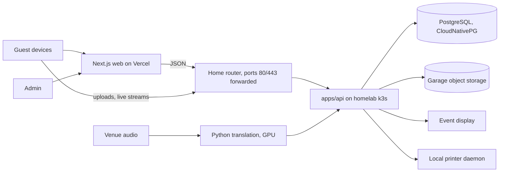

# Architecture Overview
Start as a modular monorepo, not a microservice fleet. The full design, including how each use case flows through it, the Kubernetes workloads and the network setup, is in `architecture/target-architecture.md`.

Public and cacheable surfaces run at the edge on Vercel. Authoritative private data and event services run on the homelab; the router forwards only ports 80/443 to it, directly to Traefik (ADR-009 — no Cloudflare Tunnel).
Small reads and writes go through Vercel, which caches them so invitations survive an outage. Uploads and live streams go from the browser straight to the API hostname.
New wishes and photos reach every open gallery and the event display within about a second (ADR-014): the browser follows `WS /live/gallery` (or `/live/display`) on the API, which pushes changes as soon as a Postgres `NOTIFY` from the row triggers wakes its feed, with polling as the fallback at every step. Vercel's cached listing only paints the page first.
Database, object storage, inference and printer services are never directly internet-facing.
Decisions behind this design are recorded as ADRs in `adr/README.md`: hosting split, the API application, browser-direct traffic, GitOps, storage, the homelab as system of record, venue audio ingest, the infrastructure repository and the live gallery feed.
