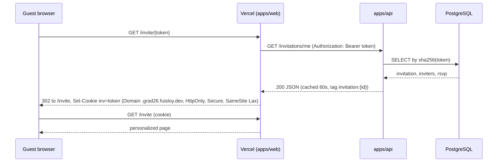
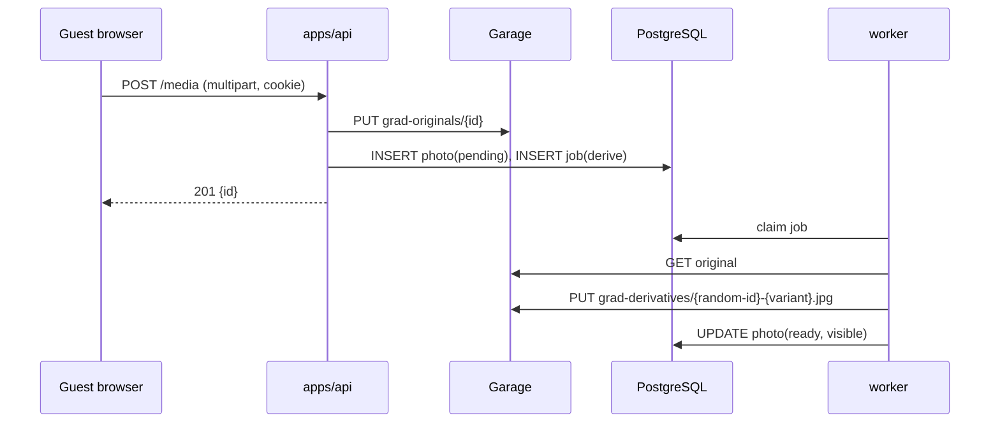
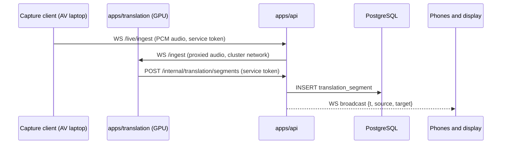

# 6. How the architecture serves the use cases

The experience arc from `product/vision.md` is Before, During, After. Each use case below lists the flow, the components involved, and what happens when something is down.

## 6.1 Before the ceremony

**Personalized invitation.** An admin creates an invitation in the admin UI on behalf of the graduate or graduates (only a few approved admins can; graduates do not sign in); the API generates a token, stores its hash, and links one or more inviters. The guest receives a link carrying the token.

Degradation: if the tunnel is down, Vercel serves the last cached invitation for that tag. A first-time visitor whose invitation was never cached sees a static "we are having trouble, here is the essential event information" page rendered by Vercel from event configuration that is also cached.

**RSVP.** The guest submits attendance from the invitation page. A server action forwards the write to the API with the cookie credential, the API validates and persists, and the action revalidates the invitation tag. If the API is unreachable the page shows an explicit retry state and keeps the form values. Nothing is queued on Vercel; a write either lands or is visibly retried.

**Calendar and directions.** Event configuration is a single JSON document owned by the API and cached on Vercel for five minutes. The calendar file is generated by the API and also cached. Both survive outages.

**Digital pass.** The API signs a compact pass payload (invitation id, guest name, validity window) and the Vercel page renders it as a QR code. The payload is signed with Ed25519 (the API holds the private key; a verifier needs only the public key named by `keyId`, decided 2026-09-29). The ceremony is a public event and door check-in is not planned, so the pass is a personalized keepsake; signature verification is not on the critical path, but the payload stays signed so a verifier can be built later.

**Pass signature scheme (v1, #35).** Enough for someone to write a verifier without reading the API code:

- `GET /pass` (invitation credential, same `401`/`404`/`410` as `GET /invitations/me`, `Cache-Control: private, no-store`) returns `{ payload, signature, keyId }` (`passResponseSchema`). The payload is `{ v: 1, invitationId, guestName, validFrom, validUntil }` and never holds email, phone, token or hash.
- **Signed bytes:** the UTF-8 encoding of `JSON.stringify` of the payload with keys in exactly the order `v, invitationId, guestName, validFrom, validUntil` and no whitespace (`canonicalPassPayload` in `@grad/contract`). Timestamps are the strings as sent (`toISOString()` form) or `null`.
- **Signature:** pure Ed25519 (RFC 8032, no pre-hash, no context) over those bytes with the private key in `PASS_SIGNING_KEY`, encoded base64url without padding (86 characters).
- **QR text:** `GP1.<keyId>.<base64url(signed bytes)>.<signature>` (`encodePassQr` in `@grad/contract`). The QR carries the signed bytes themselves, so a verifier splits on `.`, base64url-decodes the third segment and verifies it as is, with no JSON re-encoding; base64url also keeps Vietnamese names intact on scanners that misread UTF-8 in QR byte mode. `keyId` may only contain letters, digits, `-` and `_`. A strict verifier rejects segments that are not canonical base64url.
- **Public keys:** `GET /pass/keys` (public, `Cache-Control: public, max-age=300`) returns a JWK Set (`passKeysResponseSchema`): `{ keys: [{ kty: "OKP", crv: "Ed25519", x, kid, alg: "EdDSA", use: "sig" }] }`, where `kid` matches `keyId`. Rotation means a new `PASS_KEY_ID` with the new key; today only the current key is published, so passes signed with a retired key stop verifying.
- **Verifying:** find the key whose `kid` is the second segment, verify the signature over the decoded third segment, then parse it as JSON and check `v` and, if wanted, the validity window. `verifyPassQr` in `apps/api/src/modules/pass/pass.signer.ts` is the reference implementation.
- **Keys:** `PASS_SIGNING_KEY` is an Ed25519 PKCS#8 private key as PEM (literal `\n` escapes allowed) or base64 of the PEM or DER (`openssl genpkey -algorithm ed25519`). Production refuses to start without it. Elsewhere, an unset key makes the API generate an ephemeral key at startup and log a warning, so passes from a previous run no longer verify.

## 6.2 During the ceremony

**Guest camera.** The gallery page offers upload. The browser posts the file directly to the API hostname with the parent-domain cookie. The API streams it into `grad-originals`, writes a `Photo` row in `pending` state, and enqueues a derivative job. The worker generates stripped, resized variants into `grad-derivatives` and marks the photo `ready`. Photos are shown without pre-review (decided 2026-09-27); moderators can hide one afterwards or remove it on request.

Degradation: if Garage is down, uploads fail with a clear message (`503` with `Retry-After`) and the guest is asked to retry later; the invitation and everything else keep working. If the home connection is down and the venue LAN overlay exists, uploads succeed over the LAN; otherwise they wait.

**Gallery.** Vercel renders the listing from a cached API call. Image URLs point at the API's derivative endpoint. Names still carry a random unguessable identifier so they're safe to share, but there is no edge cache in front of them (ADR-009): every view fetches the derivative from the home connection directly, which is slower for guests than the original Cloudflare-cache design and adds load there on the day. Only visible, processed photos get derivative URLs, and those URLs are shown only to invited guests (the listing needs the invitation credential) until a photo is flagged public. Derivative responses are `Cache-Control: public, max-age=31536000, immutable`, since a name never changes content, so a guest's browser fetches each image from the home connection once. A moderator hiding or removing a photo revalidates the listing tag, and the API stops serving its derivatives on the next request (browsers that already hold a copy keep it).

**Wishes.** Small text writes follow the RSVP pattern. Wishes appear on the event display while they are visible; a moderator can hide one at any time.

**Live translation.** The capture client streams audio from the mixer to `WS /live/ingest` on the API, which authenticates it and proxies it to the translation service's ingest WebSocket over the cluster network. The GPU service emits segments and posts them to the API, which stores them and broadcasts over `WS /live/translation` to phones and `WS /live/display` to the kiosk.

Degradation: the translation pod is a Flux Kustomization that can be suspended. If it is absent the API still serves everything else and the live page shows "translation unavailable". Phones reconnect automatically with backoff; missed segments are refetched by timestamp.

How it works (#68). The wire shapes and the ingest protocol are in `packages/contract/src/translation.ts` and `live.ts`.

- **Ingest auth.** The capture client opens `WS /live/ingest` with `Authorization: Bearer <SERVICE_TOKEN_INGEST>`, its own token, so a leaked capture laptop can't post segments and the translation service's token can't stream audio. Unset, ingest refuses everyone; it is optional even in production so the API never fails to boot over an experimental feature.
- **Audio.** Binary frames of raw PCM, 16 kHz mono s16le, 20 to 200 ms each (at most 16 KiB). Optional JSON text frames carry control messages (`start` with `sessionId`, `sourceLanguage`; `stop`); any JSON object with a `type` is relayed, so the two ends can add messages without an API change. The API relays frames verbatim and in order to `TRANSLATION_INGEST_URL` over the cluster network, opening that socket with `Authorization: Bearer <SERVICE_TOKEN_TRANSLATION>` so the service can check the caller. It replays the last `start` after every upstream reconnect, before any audio.
- **One capture client.** The newest connection wins: an earlier one is closed with code `4001` and must not reconnect by itself. Taking over (rather than refusing the second) lets a laptop that dropped off Wi-Fi reconnect at once instead of waiting for its half-open socket to time out.
- **Back-pressure and absence.** The upstream socket exists only while a capture client is connected and is re-dialled with backoff (0.5 s doubling to 10 s). Audio is never queued: while the service is unreachable, or more than 256 KiB (about 8 s of audio) is waiting to be sent to it, frames are dropped and counted. The capture client gets `{ type: "status", upstream: "connected" | "unavailable", droppedFrames }` on connect and on every change. Both sockets are pinged every 15 seconds and dropped after a missed pong. No audio content or token is ever logged.
- **Segments.** The service posts each segment to `POST /internal/translation/segments` (token `translation`). The API stores it once per `(sessionId, sequence)`; the source text is never revised. Translations merge per language: a draft or failure is replaced by anything newer, except that a failure never hides a usable draft, and a `final` is never revised. A re-post that changes nothing is answered `changed: false` and not broadcast. Storage down is `503` with `Retry-After`, so the service retries.
- **Fan-out.** `WS /live/translation?lang=de|en|vi` is public, like the ceremony: captions are what is said on stage, nothing per guest. Browsers must come from `PUBLIC_ORIGIN`. On connect a client gets `status`, then the 50 most recent segments, then every change, each segment filtered to its language; the display gets every change with all languages on `WS /live/display`. The API keeps the 200 most recently changed segments in memory, which answers the snapshot and most catch-up without the database. Listeners are pinged every 25 seconds, get a `keepalive` with `until` as often, and a listener with more than 1 MB queued is dropped and catches up on reconnect. At most `LIVE_TRANSLATION_MAX_CLIENTS` (default 1000) listeners connect at once; beyond that the handshake is `503` and the page polls the catch-up endpoint instead.
- **Catch-up.** `GET /live/translation/segments?since=<until>&lang=<de|en|vi>` returns every segment stored or re-translated after `since`, oldest change first, with `until` (the next `since`), `more` when `limit` cut it short, and `state`. Clients apply segments idempotently by `(sessionId, sequence)`. Timestamps are the database's clock, and every catch-up looks back 5 seconds behind `since` so a change that committed late is not missed.
- **Availability.** `state` is `live` while a capture client streams to a connected translation service, or for 60 seconds after the last segment (so a provider posting without ingest, such as the mock, also counts); otherwise `unavailable`, broadcast as a `status` message whenever it changes.

**Event display.** A browser in kiosk mode opens `/display` and connects to `WS /live/display`. The feed carries visible wishes, selected photos and translation. The page shell comes from Vercel unless the venue overlay runs the web mirror, in which case it comes from the LAN.

How the feed works (#65):

- **Auth.** The display shows guest-only photos, so the socket and its catch-up need the invitation credential like any guest route. The kiosk gets its own invitation (for example a guest named "Event display"). Someone opens its link once on the kiosk browser, the usual cookie exchange sets `inv` on `.grad26.fuisloy.dev`, and the browser sends that cookie on the WebSocket handshake. No token ever goes in the socket URL. The handshake is also refused (`403`) when a browser's `Origin` isn't `PUBLIC_ORIGIN`, so another site can't ride a guest's cookie. Revoking the kiosk's invitation stops new connections; an open socket stays until it reconnects.
- **Messages** (`liveDisplayMessageSchema`): `wish` and `photo` add or update an item, and `hidden` takes one off screen. A photo is shown once it is `visible` and `ready`; a photo's `id` is its `publicId`. `keepalive` arrives about every 25 seconds with `until`. The server also sends WebSocket pings every 25 seconds, so Traefik, NAT and venue Wi-Fi don't drop a quiet socket, and it drops a client that misses a pong.
- **Reconnect.** Open the socket first, then call `GET /live/display/feed`: without `since` it returns the current state (newest 100 visible wishes and photos), and with `since` set to the last `until` (from a keepalive or an earlier catch-up) it returns every change after it. Apply messages idempotently by id, because catch-up can repeat what the socket already delivered.
- **Mechanism.** The API polls Postgres every 2 seconds, and only while a display is connected, for wishes and photos whose `updated_at` moved. Each poll looks back 5 seconds so a row whose transaction committed just after a poll is not missed, and deduplicates what it has already sent. A trigger keeps `updated_at` current on every update, so it doesn't matter which process wrote the change: the api for wish moderation, the worker for photo processing. Polling was chosen over `LISTEN/NOTIFY` because it reads only committed rows, needs no dedicated listening connection to keep alive and re-subscribe after a database restart, and doesn't need every writer to remember a `NOTIFY`. With a single API replica, a 2-second delay on a projector is invisible, and the cost is two small queries every 2 seconds. With more replicas, each polls independently, which is still correct.

**Printing.** An admin or, optionally, a guest requests a print of a visible photo (`POST /print/jobs`; guests only when `PRINT_GUEST_REQUESTS_ENABLED=true`, from the photo dialog on `/gallery` through the web BFF `POST /api/print`, which shows the action only when the web app has the same flag set, #74). The API records it in the durable `print_jobs` queue; the printer daemon on the venue node polls `GET /internal/print/jobs/next`, which claims the oldest job under a five-minute lease, fetches the derivative, prints through CUPS, and reports with `POST /internal/print/jobs/{id}/done`. If the daemon is absent the queue simply grows and can be drained later; an unreported lease puts the job back in the queue (details in `data-model.md`).

## 6.3 After the ceremony

**Curated gallery and cohort timeline.** Moderators flag a subset public (`POST /admin/media/{publicId}/public`, `POST /admin/wishes/{id}/public`). Public pages render from Vercel with the same cached listing calls, `GET /gallery/public` and `GET /wishes/public`, which return only items that are visible and flagged; unflagged items never appear there. Originals stay in `grad-originals` and never leave. Decided 2026-10-19: the event gallery `/gallery` stays as it is (every visible item), and the curated view is a separate archive at `/memories` with the cohort timeline at `/memories/timeline`; both are static pages on Vercel tagged `gallery-public`, `wishes-public` (and `event`), so admin revalidation reaches them (`design/memories-archive.md`).

**Yearbook and memory archive.** The four-year archive is the Postgres data plus the two media buckets plus the offsite copy. Because everything is defined in git and restorable from backups, the archive can be re-hosted anywhere later without redesign.

## 6.4 Cross-cutting

**Anonymous visitors** see Vercel-served pages, the photo gallery and the wishes. Decided 2026-09-30: invited guests are trusted, so photos and wishes appear without pre-review, and both are public so people who aren't guests can follow the graduation day. Anonymous requests reach the API only for these cached, read-only listings (`GET /gallery`, `GET /wishes`, and the curated `GET /gallery/public` and `GET /wishes/public`, #75) and derivative fetches (`GET /media/{id}/{variant}`). Posting a photo or a wish still needs an invitation. Moderation is takedown only: an admin can hide or remove an item after the fact. There is no approval queue.

**Admins** sign in on Vercel; the web app mints a short-lived session token that the API verifies with a shared secret. All admin actions are recorded in the `audit` table.

## 6.5 Degradation matrix

| Failure | Still works | Lost until recovery |
| --- | --- | --- |
| Homelab, router, or the home connection down | Landing, docs, cached invitations, cached event info, pass validation, static fallback | RSVP and wish writes, uploads, live features, admin |
| Vercel down | Direct API paths: uploads, live, display, derivatives; venue LAN if present | All pages unless the web mirror is deployed |
| Dynamic DNS stale (ADR-009) | Venue LAN only, until someone notices and fixes the record | Everything internet-facing that resolves the stale IP |
| PostgreSQL down | Cached pages, static fallback via Traefik errors middleware | All API reads and writes |
| Garage down | Invitations, RSVP, wishes, live translation | Uploads, uncached derivatives, backups |
| Translation pod down | Everything else | Live translation |
| Printer down | Everything else | Printing, queue retained |
| GPU driver failure | Everything else | Live translation |
